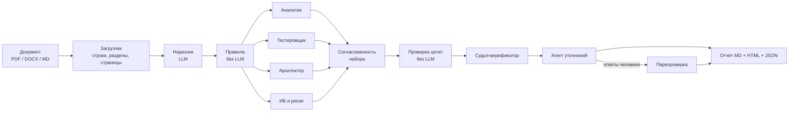

# Ревизор ТЗ

[](https://github.com/ERA216/Hac/actions/workflows/tests.yml)

**Мультиагентная статическая проверка документа требований** для BCC-HUB x MNU FinTech Hackathon.

Агент читает ТЗ (PDF, DOCX, Markdown, TXT), выделяет отдельные требования и проверяет каждое из них и весь набор по критериям ISO/IEC/IEEE 29148:2018 (п. 5.2.5–5.2.7) и IEEE Std 830-1998 (п. 4.3). Затем **задаёт уточняющие вопросы** автору ТЗ, принимает ответы, перепроверяет дефекты и выпускает отчёт на русском языке.

**Результат на выданном ТЗ:**
- **Отчёт:** [Markdown](reports/report.md), интерактивный [HTML](reports/report.html) (скачайте и откройте в браузере), [JSON](reports/report.json).
- **Итог:**
  - 37 требований, 26 дефектов (🔴 5 · 🟠 15 · 🟡 6);
  - 10 уточняющих вопросов, 5 из них блокирующих;
  - **53 из 53 цитат подтверждены** в документе;
  - **12 из 12 ключевых** заложенных дефектов найдены, 25 из 27 по полному эталону ([оценка](eval/RESULTS.md)).

## Чем отличается от «одного промпта»

- **Ни одной выдуманной цитаты.** Каждая цитата программно ищется в документе. Находки, цитату которых агент не нашёл, отбрасываются. В паспорте видно, сколько цитат проверено и подтверждено.
- **Команда агентов с ролями:**
  - нарезчик;
  - четыре ревьюера: аналитик, тестировщик, архитектор, ИБ и риски (работают параллельно);
  - агент согласованности набора;
  - судья-верификатор;
  - агент уточнений и агент перепроверки.
- **Детерминированные правила без LLM:**
  - язык требований (29148 п. 5.2.7);
  - незаполненные шаблоны;
  - смешение денежных единиц;
  - семантика HTTP и кодов ответа;
  - типы параметров API;
  - идентификаторы и персональные данные в URL;
  - разделы шаблона ТЗ и нумерация требований;
  - чек-лист ревью финтех-ТЗ: НФТ без числового показателя, границы периода без часового пояса, защита от повторов без ключа идемпотентности, неопределённый этап операции (авторизация или клиринг).
- **Уточняющие вопросы с готовыми вариантами ответа.** Ответы можно дать тремя способами:
  - в консоли (`--interactive`);
  - в веб-интерфейсе;
  - прямо в HTML-отчёте: кнопка «Скачать ответы» сохраняет файл, который подаётся агенту через `--answers`.

  Агент перепроверки закрывает дефекты, снятые ответами.
- **Отчёт для внедрения:**
  - заполненный чек-лист банка «Ревью требований»;
  - матрица трассируемости;
  - недостающие тест-кейсы с граничными значениями;
  - исправленные формулировки требований;
  - список того, что исправить в первую очередь.
- **Воспроизводимость:**
  - версия агента (git) и SHA-256 документа в паспорте;
  - ответы модели финального прогона лежат в репозитории, поэтому `--replay` пересобирает отчёт без ключа и сети;
  - ревьюеры работают параллельно, но результат детерминирован.
- **Устойчивость:**
  - цепочка резервных моделей при перегрузке (503) и исчерпании квоты;
  - сбой одного агента не обрывает прогон.

## Быстрый старт

Нужен Python 3.11 или новее.

```powershell
python -m venv .venv
.venv\Scripts\activate          # Linux/macOS: source .venv/bin/activate
pip install -r requirements.txt
```

### Без ключа: воспроизвести финальный отчёт

```powershell
python -m revizor examples/requirements.md reports/replay.md --replay
```

Ответы модели берутся из `reports/llm-cache`. Содержание отчёта (нарезка, дефекты, вопросы, итог) совпадёт с [reports/report.md](reports/report.md), отличаться будут только дата и отметка «из кэша» в паспорте.

Точное совпадение гарантировано на той версии кода, которой построен отчёт: она указана в его паспорте и помечена тегом `report-v1`. Если код новее и в нём изменились правила или промпты, агенты получат другой вход. Тогда недостающие шаги пометятся в отчёте как невыполненные.

```powershell
git checkout report-v1
python -m revizor examples/requirements.md reports/replay.md --replay
```

### Ключ LLM

1. Откройте [Google AI Studio](https://aistudio.google.com/) и нажмите **Get API key**, затем **Create API key**. Бесплатного тарифа достаточно.
2. Скопируйте пример конфига и впишите ключ:
   ```powershell
   copy .env.example .env
   ```
   В файле `.env` укажите `GEMINI_API_KEY=ваш_ключ`. Файл `.env` в git не попадает.
3. Проверьте окружение одной командой: Python, зависимости, ключ, доступность моделей, Ollama, кэш, запись отчётов. Квота при этом не тратится.
   ```powershell
   python -m revizor --check
   ```
   Список моделей, доступных вашему ключу: `python -m revizor --list-models`.

### Запуск прогона

```powershell
python -m revizor examples/requirements.md reports/report.md
```

Агент принимает путь к файлу требований (`.pdf`, `.docx`, `.md`, `.txt`) и путь к отчёту. Прогон занимает несколько минут и около 8 запросов к модели. Рядом с `report.md` появятся:
- `report.html` — интерактивный отчёт;
- `report.json` — все данные и журнал вызовов модели;
- `report.defects.csv` и `report.questions.csv` — дефекты и вопросы для импорта в Excel или Jira.

С уточняющими вопросами в консоли:

```powershell
python -m revizor examples/requirements.md reports/report.md --interactive
```

С ответами из файла (`{"Q-01": "1", "Q-02": "свой ответ"}`: номер варианта или текст):

```powershell
python -m revizor examples/requirements.md reports/report.md --answers answers.json
```

### Веб-интерфейс для демонстрации

```powershell
streamlit run app.py
```

Порядок работы в интерфейсе:
1. Загрузите документ или нажмите «Взять пример ТЗ хакатона».
2. Нажмите «Проверить документ» и смотрите, как работают агенты.
3. Ответьте на уточняющие вопросы и нажмите «Перепроверить».
4. Скачайте отчёт.

Режим модели выбирается в боковой панели:
- **Gemini** — облако;
- **Ollama** — локальная модель, документ не покидает компьютер;
- **Только кэш** — без ключа и сети.

## Модель

| Что | Значение |
| :--- | :--- |
| По умолчанию | Google Gemini `gemini-3.8-flash` (бесплатный тариф AI Studio). Фактическая версия модели пишется в паспорт отчёта. |
| Резервные модели | `gemini-3.7-flash` → `3.6-flash` → `3.5-flash` → `3.5-flash-lite` → `3.1-flash-lite` → `2.5-flash`. При перегрузке (503), отсутствии модели (404) или исчерпании дневной квоты агент сам переходит к следующей. Список задаётся в `GEMINI_FALLBACK_MODELS` или `--fallback-models`. |
| Квоты | Бесплатный тариф даёт 20 запросов в день на каждую модель. Один прогон — около 8 запросов, с резервной цепочкой хватает на несколько прогонов в день. |
| Локальная модель (контур банка) | `LLM_PROVIDER=ollama`, `OLLAMA_MODEL=qwen3:4b` (или крупнее), `OLLAMA_NUM_CTX=24576`. Документ не покидает компьютер. Используется родной API Ollama: окно контекста, JSON-схема, без «размышлений». |
| Другие провайдеры | `LLM_PROVIDER=openai`: OpenAI, OpenRouter, LM Studio, vLLM (`OPENAI_BASE_URL`) |
| Лимиты прогона | 5 запросов в минуту (`LLM_RPM`), не больше 12 новых вызовов (`LLM_MAX_CALLS`), 4 параллельных ревьюера (`--parallel`) |
| Кэш | Ответы модели кэшируются в `.cache/llm`, повторная проверка того же документа бесплатна |

## Архитектура



| Агент | Задача | Критерии |
| :--- | :--- | :--- |
| Нарезчик | Выделяет требования с цитатами и исходными ID | — |
| Правила (код) | Язык, шаблоны, единицы, HTTP, типы API, данные в URL | 29148 п. 5.2.7, полнота, согласованность |
| Аналитик | Однозначность, полнота, атомарность, уместность, корректность | 29148 п. 5.2.5 |
| Тестировщик | Проверяемость; сверка каждой строки критериев приёмки с требованиями; недостающие тесты | 29148 п. 5.2.5–5.2.6, IEEE 830 п. 4.3.6 |
| Архитектор | API, интеграция, данные, обработка событий, реализуемость | 29148 п. 5.2.5 |
| ИБ и риски | Персональные и карточные данные, авторизация, операционные риски, откат | чек-лист ревью банка |
| Согласованность | Противоречия, терминология, полнота набора, трассируемость | 29148 п. 5.2.6, IEEE 830 п. 4.3 |
| Проверка цитат (код) | Нечёткий поиск каждой цитаты в документе, отбрасывание неподтверждённых находок | — |
| Судья | Отсекает ложные находки, объединяет дубли, ставит критичность и приоритеты, заполняет чек-лист, выносит вердикт | — |
| Уточнения | Вопросы к автору ТЗ с вариантами ответа, блокирующие идут первыми | — |
| Перепроверка | Учитывает ответы: закрывает, меняет или оставляет дефекты | — |

Как устроены надёжность и воспроизводимость:
- Ответы модели валидируются Pydantic-схемами, при ошибке схемы делается одна попытка починки.
- Ревьюеры вызываются параллельно, но их результаты обрабатываются в фиксированном порядке. Поэтому кэш и `--replay` дают тот же отчёт.
- Решение «можно ли начинать разработку» дополнительно проверяется правилом: при открытых критичных дефектах ответ всегда «нет».

## Состав отчёта

1. Паспорт прогона: документ, SHA-256, дата, модель и её фактическая версия, версия агента (git), вызовы и токены, проверка цитат.
2. Нарезка: «ID в отчёте — ID в документе — краткая формулировка — цитата — место».
3. Проверка каждого требования: матрица и дефекты с цитатами, критерием, проблемой, исправлением и новой формулировкой.
4. Проверка набора:
   - оценка по критериям 29148 п. 5.2.6 и IEEE 830 п. 4.3;
   - трассируемость;
   - заполненный чек-лист ревью.
5. Уточняющие вопросы с вариантами ответа (и ответы, если они даны).
6. Недостающие тест-кейсы.
7. Сводка: число требований и нарушений, разбивка по критериям, критичные дефекты.
8. Итог: можно ли начинать разработку и тестирование, что исправить в первую очередь.
9. Приложения:
   - исправления текста ТЗ «было → стало»;
   - трассировка работы агентов и вызовов модели;
   - отклонённые находки;
   - методика.

Что есть в HTML-версии:
- исходный документ с подсветкой проблемных строк (как в код-ревью);
- тепловая карта «требование × критерий»;
- фильтры дефектов;
- форма ответов на вопросы.

## Оценка качества

В `eval/golden.json` лежит эталон из 27 заложенных в ТЗ дефектов. Он размечен вручную, со ссылками на строки документа. Агенту эталон не передаётся. Оценить любой отчёт:

```powershell
python eval/score.py reports/report.json
```

Финальный отчёт: **12 из 12 ключевых** дефектов, 25 из 27 всех, 53 из 53 цитат подтверждены ([подробно](eval/RESULTS.md)).

| Документ | Одни правила, без LLM | Агенты + правила |
| :--- | :--- | :--- |
| Выданное ТЗ (27 дефектов, 12 ключевых) | 7 из 12 ключевых, 14 из 27 | **12 из 12 ключевых, 25 из 27** |
| Второе ТЗ (17 дефектов, 8 ключевых) | 5 из 8 ключевых, 12 из 17 | прогон на модели — после обновления квоты |
| Чистое ТЗ без дефектов | 0 ложных срабатываний | — |

Чтобы проверить, что агент не подогнан под выданный документ, есть второе, незнакомое ему ТЗ: [eval/cases/p2p](eval/cases/p2p/requirements.md) («Переводы по номеру телефона»). В нём 17 намеренно заложенных дефектов.

```powershell
python -m revizor eval/cases/p2p/requirements.md reports/p2p.md
python eval/score.py reports/p2p.json --golden eval/cases/p2p/golden.json
```

Противоречия между частями документа, неоднозначности формулировок и риски персональных данных добавляют LLM-агенты. Правила страхуют от разброса LLM от прогона к прогону.

В `report.json` сохраняются и все находки агентов до судьи (`candidates`). По ним видно, что судья объединил (`candidate_ids` у итоговых дефектов) и что отклонил (`rejected`).

## Устойчивость

- **Модель недоступна.**
  - Если LLM-нарезчик не отвечает, документ режется по структуре: пункты, нумерованные шаги, строки таблиц.
  - Если отказали ревьюеры или судья, в отчёт попадают находки правил, а пропущенный шаг помечается.
  - Отчёт выпускается всегда.
- **Длинный документ** нарезается по частям по заголовкам, чтобы ответ модели не обрезался.
- **Формат ТЗ.** Если документ оформлен по банковскому шаблону, отдельное правило проверяет наличие обязательных разделов. Ещё одно правило проверяет нумерацию требований: пропуски, дубли и ссылки на несуществующие пункты.
- **Документы без разметки.** В TXT и DOCX без стилей заголовки распознаются по нумерации («2.1 Начисление»), ЗАГЛАВНЫМ буквам и жирному шрифту. Нумерованные списки при этом не путаются с заголовками.
- **Ошибки настройки.** При неверном ключе, отсутствии доступа, несуществующей модели или незапущенной Ollama прогон сразу останавливается с понятным сообщением. Он не выдаёт неполный отчёт и не тратит минуты на повторы.
- **Точность правил.** На аккуратно составленном ТЗ ([tests/fixtures/clean.md](tests/fixtures/clean.md)) правила не дают ни одного ложного срабатывания. Это закреплено тестом.
- **Перепроверка по ответам.** Статус «закрыт уточнением» сверяется с обоснованием агента. Если там сказано, что ответ дефект не снимает, дефект остаётся открытым.

## Параметры командной строки

| Параметр | Назначение |
| :--- | :--- |
| `input report` | Файл требований и путь к отчёту (`.md`) |
| `--interactive`, `-i` | Задать уточняющие вопросы в консоли и перепроверить дефекты |
| `--answers FILE` | Взять ответы из файла |
| `--provider gemini\|openai`, `--model`, `--base-url` | Выбор модели |
| `--fallback-models a,b,c` | Резервные модели |
| `--replay` | Только сохранённые ответы модели (без сети и ключа) |
| `--no-cache`, `--cache-dir DIR` | Управление кэшем |
| `--max-calls N`, `--rpm N`, `--parallel N` | Бюджет вызовов, лимит частоты, параллельность ревьюеров |
| `--check` | Проверка окружения: зависимости, ключ, модели, Ollama (квоту не тратит) |
| `--list-models` | Список доступных моделей Gemini |

## Структура репозитория

```
revizor/
  __main__.py        CLI
  config.py          настройки модели из .env
  check.py           проверка окружения (--check)
  document.py        загрузка PDF/DOCX/MD/TXT → строки с разделами и страницами
  llm.py             провайдеры, JSON-схемы, кэш, лимиты, резервные модели, трассировка
  rules.py           детерминированные проверки
  segmentation.py    нарезка без LLM и деление длинных документов
  verify.py          проверка цитат по документу
  criteria.py        каталог критериев 29148 / IEEE 830
  schemas.py         контракты ответов агентов (Pydantic)
  agents/            агенты: базовый класс, роли, контекст
  prompts/           промпты агентов (Jinja2) и чек-листы ревьюеров (prompts/lenses)
  orchestrator.py    граф шагов, параллельные ревьюеры, ответы и перепроверка
  report/            Markdown, JSON и интерактивный HTML
app.py               веб-интерфейс (Streamlit)
examples/            выданный документ требований (MD — оригинал, PDF — для проверки чтения PDF)
reports/             финальный отчёт и ответы модели для --replay
eval/                эталоны дефектов, второе тестовое ТЗ и скрипт оценки
tests/               тесты с фейковой моделью (без сети)
```

## Тесты

```powershell
pytest -q
```

50 тестов работают без ключа и сети, покрытие кода — 89%. Они проверяют:
- загрузку MD, PDF, DOCX и TXT, в том числе документов без разметки заголовков;
- поиск цитат и правила: на выданном ТЗ, на втором незнакомом ТЗ и отсутствие ложных срабатываний на чистом ТЗ;
- весь конвейер, ответы и перепроверку, противоречивые статусы, работу при недоступной модели, нарезку длинных документов;
- остановку при ошибках настройки (неверный ключ, незапущенная Ollama) и проверку окружения;
- LLM-клиент на имитации ошибок API: повторы, перегрузка и переход к резервной модели, дневная квота, починку неверного и обрезанного JSON, кэш, бюджет;
- CLI целиком: прогон, ответы из файла, ошибки ввода, код выхода при фатальной ошибке;
- провайдер Ollama (на имитации API), HTML, CSV;
- совпадение результатов параллельного и последовательного режима.

Качество кода проверяется инструментами:
- линтер: `ruff check .` и `ruff format --check .`;
- проверка типов: `mypy` (настройки в `pyproject.toml`);
- покрытие тестами: `pytest --cov=revizor`.

На каждом пуше GitHub Actions запускает тесты, прогон без ключа, оценку по эталону, линтер и проверку типов.
