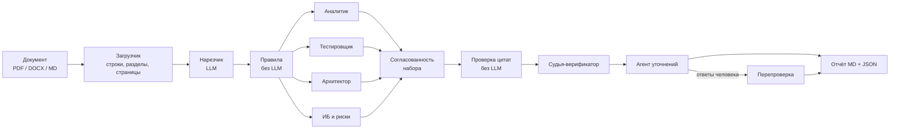

# Ревизор ТЗ

**Мультиагентная статическая проверка документа требований** для BCC-HUB x MNU FinTech Hackathon.

Агент читает ТЗ (PDF, DOCX, Markdown, TXT), выделяет отдельные требования и проверяет каждое из них и весь набор по критериям ISO/IEC/IEEE 29148:2018 (п. 5.2.5–5.2.7) и IEEE Std 830-1998 (п. 4.3). Затем задаёт уточняющие вопросы автору ТЗ и выпускает отчёт на русском языке.

Чем он отличается от «одного промпта»:

- **Каждая цитата в отчёте сверена с документом.** Находки, цитату которых агент не нашёл в тексте, отбрасываются. В паспорте отчёта видно, сколько цитат проверено и подтверждено.
- **Команда агентов с разными ролями:** нарезчик, четыре ревьюера (аналитик, тестировщик, архитектор, ИБ и риски), агент согласованности набора, судья-верификатор, агент уточнений и агент перепроверки.
- **Детерминированные правила без LLM:** язык требований (29148 п. 5.2.7), незаполненные шаблоны, смешение денежных единиц, семантика HTTP, типы параметров API, идентификаторы в URL.
- **Уточняющие вопросы с готовыми вариантами ответа.** В интерактивном режиме агент принимает ответы, перепроверяет затронутые дефекты и закрывает те, что сняты уточнением.
- **Отчёт для внедрения:**
  - заполненный чек-лист «Ревью требований»;
  - матрица трассируемости;
  - недостающие тест-кейсы с граничными значениями;
  - исправленные формулировки требований;
  - список того, что исправить в первую очередь.
- **Экономия бесплатной квоты:** около 8 вызовов LLM на прогон, кэш ответов и режим `--replay` без сети.

## Быстрый старт

Нужен Python 3.11 или новее.

```powershell
python -m venv .venv
.venv\Scripts\activate          # Linux/macOS: source .venv/bin/activate
pip install -r requirements.txt
```

### Ключ LLM

1. Откройте [Google AI Studio](https://aistudio.google.com/) и нажмите **Get API key**, затем **Create API key**. Бесплатного тарифа достаточно.
2. Скопируйте пример конфига и впишите ключ:
   ```powershell
   copy .env.example .env
   ```
   В файле `.env` укажите `GEMINI_API_KEY=ваш_ключ`. Файл `.env` в git не попадает.
3. Необязательно: посмотрите, какие модели доступны вашему ключу.
   ```powershell
   python -m revizor --list-models
   ```

### Запуск

Агент принимает путь к файлу требований и путь к файлу отчёта:

```powershell
python -m revizor examples/requirements.pdf reports/report.md
```

Отчёт ляжет в `reports/report.md`. Рядом появится `reports/report.json` со всеми находками, вопросами, трассировкой и журналом вызовов модели.

С уточняющими вопросами в консоли (ответы сохраняются в `reports/report.answers.json`):

```powershell
python -m revizor examples/requirements.pdf reports/report.md --interactive
```

С ответами из файла (JSON `{"Q-01": "1"}`: номер варианта или свой текст):

```powershell
python -m revizor examples/requirements.pdf reports/report.md --answers reports/report.answers.json
```

## Модель

| Что | Значение |
| :--- | :--- |
| По умолчанию | Google Gemini, `gemini-flash-latest` (псевдоним актуальной Flash-модели). Фактическая версия модели пишется в паспорт отчёта. |
| Сменить модель | `GEMINI_MODEL` в `.env` или `--model` |
| Если кончилась квота | Flash-Lite-модель с более высокими лимитами |
| Другие провайдеры | `LLM_PROVIDER=openai`: OpenAI, OpenRouter, LM Studio, vLLM, Ollama (`OPENAI_BASE_URL=http://localhost:11434/v1`) |
| Лимиты | По умолчанию 5 запросов в минуту (`LLM_RPM`) и не больше 12 новых вызовов на прогон (`LLM_MAX_CALLS`). При ответе 429 агент ждёт и повторяет запрос. |
| Кэш | Ответы модели кэшируются в `.cache/llm`. Повторный прогон того же документа бесплатен, `--replay` работает без сети. |

## Архитектура



| Агент | Задача | Критерии |
| :--- | :--- | :--- |
| Нарезчик | Выделяет атомарные требования с цитатами и исходными ID | — |
| Правила (код) | Язык, шаблоны, единицы, HTTP, типы API, данные в URL | 29148 п. 5.2.7, полнота, согласованность |
| Аналитик | Однозначность, полнота, атомарность, уместность | 29148 п. 5.2.5 |
| Тестировщик | Проверяемость; сверка каждого критерия приёмки с требованиями; недостающие тесты | 29148 п. 5.2.5–5.2.6, IEEE 830 п. 4.3.6 |
| Архитектор | API, интеграция, данные, обработка событий, реализуемость | 29148 п. 5.2.5 |
| ИБ и риски | Персональные и карточные данные, авторизация, операционные риски, откат | чек-лист ревью банка |
| Согласованность | Противоречия, терминология, полнота набора, трассируемость | 29148 п. 5.2.6, IEEE 830 п. 4.3 |
| Проверка цитат (код) | Каждая цитата ищется в документе нечётким поиском; находки без подтверждения отбрасываются | — |
| Судья | Отсекает ложные срабатывания, объединяет дубли, ставит критичность и приоритеты, заполняет чек-лист, выносит вердикт | — |
| Уточнения | Вопросы к автору ТЗ с вариантами ответов, блокирующие идут первыми | — |
| Перепроверка | Учитывает ответы: закрывает, меняет или оставляет дефекты | — |

Устойчивость:
- ответы модели валидируются Pydantic-схемами, при ошибке схемы делается одна попытка починки;
- сбой одного агента не обрывает прогон: отчёт выходит с пометкой, какой шаг не выполнен;
- итоговое решение «можно ли начинать разработку» проверяется правилом: при открытых критичных дефектах ответ всегда «нет».

## Состав отчёта

1. Паспорт прогона: документ, SHA-256, дата, модель и её фактическая версия, версия агента (git), вызовы и токены, проверка цитат.
2. Нарезка: «ID в отчёте — ID в документе — краткая формулировка — цитата — место».
3. Проверка каждого требования: матрица и дефекты с цитатами, критерием, проблемой, исправлением и новой формулировкой.
4. Проверка набора:
   - оценка по критериям 29148 п. 5.2.6 и IEEE 830 п. 4.3;
   - трассируемость;
   - заполненный чек-лист ревью.
5. Уточняющие вопросы с вариантами ответа.
6. Недостающие тест-кейсы.
7. Сводка: число требований и нарушений, разбивка по критериям, критичные дефекты.
8. Итог: можно ли начинать разработку и тестирование, что исправить в первую очередь.
9. Приложения: трассировка работы агентов, отклонённые судьёй находки, находки без подтверждённых цитат, методика.

## Параметры командной строки

| Параметр | Назначение |
| :--- | :--- |
| `input report` | Файл требований и путь к отчёту (`.md`) |
| `--interactive`, `-i` | Задать уточняющие вопросы в консоли и перепроверить дефекты |
| `--answers FILE` | Взять ответы из файла |
| `--provider gemini\|openai`, `--model`, `--base-url` | Выбор модели |
| `--replay` | Только сохранённые ответы модели (без сети и ключа) |
| `--no-cache` | Не использовать кэш |
| `--max-calls N`, `--rpm N` | Бюджет вызовов и лимит частоты |
| `--list-models` | Список доступных моделей Gemini |

## Структура репозитория

```
revizor/
  __main__.py        CLI
  document.py        загрузка PDF/DOCX/MD/TXT → строки с разделами и страницами
  llm.py             провайдеры, JSON-схемы, кэш, лимиты, повторы, трассировка
  rules.py           детерминированные проверки
  verify.py          проверка цитат по документу
  criteria.py        каталог критериев 29148 / IEEE 830
  schemas.py         контракты ответов агентов (Pydantic)
  agents/            агенты: базовый класс, роли, контекст
  prompts/           промпты агентов (Jinja2)
  orchestrator.py    граф шагов и состояние прогона
  report/            генерация Markdown и JSON
examples/            выданный документ требований (MD и PDF)
tests/               тесты с фейковой моделью (без сети)
```

## Тесты

```powershell
pytest -q
```

Тесты проверяют загрузку MD и PDF, поиск цитат, правила и весь конвейер с фейковой моделью. Ключ для них не нужен.
